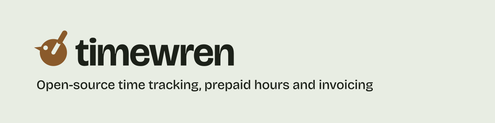

<picture>
  <source media="(prefers-color-scheme: dark)" srcset="readme-banner-dark.svg">
  
</picture>

**Open-source time tracking, prepaid hours and invoicing for freelancers and small agencies.**

TimeWren tracks your hours, keeps count of the prepaid hour packages your clients buy, and turns tracked time into invoices in your accounting system. It is the same code that runs the Danish TimeTrack service, now open under AGPL-3.0.

Every feature is in the open repository. There is no enterprise edition and no CLA.

### Try it

```bash
curl -fsSL https://timewren.com/install.sh | bash
```

That installs TimeWren with Docker Compose on a Linux server. Prefer a platform? There are guides for [Docker Compose](https://timewren.com/docs/install/docker-compose), [Coolify](https://timewren.com/docs/install/coolify), [Dokploy](https://timewren.com/docs/install/dokploy), [Railway](https://timewren.com/docs/install/railway), [Render](https://timewren.com/docs/install/render) and [Kubernetes](https://timewren.com/docs/install/kubernetes).

Don't want to run a server? [TimeWren Cloud](https://timewren.com) is hosted in the EU, and paying for it is what funds development.

### What's in the box

- **Prepaid hours.** Clients buy a block of hours. Every entry draws from it, with alerts before it runs out and a portal where the client can follow along.
- **Invoices.** PDF, or straight into Billy, Dinero or e-conomic, with payment status synced back.
- **Tracking where you work.** Timer, manual entries, calendar, browser extension, mobile apps and a desktop app that keeps raw activity on your machine.
- **An MCP server.** Let Claude or ChatGPT log and look up time over OAuth, with scopes you approve.
- **Teams.** Organisations, roles, approvals and an audit log.

### Repositories

| | |
| --- | --- |
| [timewren](https://github.com/timewren/timewren) | Web app and server (Next.js, PostgreSQL). AGPL-3.0. |

### Links

[Website](https://timewren.com) · [Docs](https://timewren.com/docs) · [Docs for your LLM](https://timewren.com/llms.txt) · [Contributing](https://timewren.com/docs/contributing) · [support@timewren.com](mailto:support@timewren.com)

<sub>TimeWren is made in Denmark by <a href="https://mahoje.dk">Mahope</a>.</sub>
